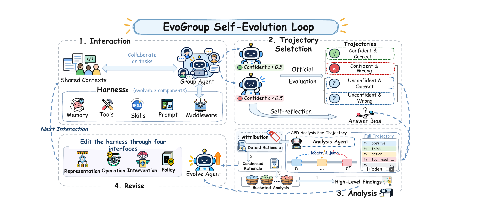
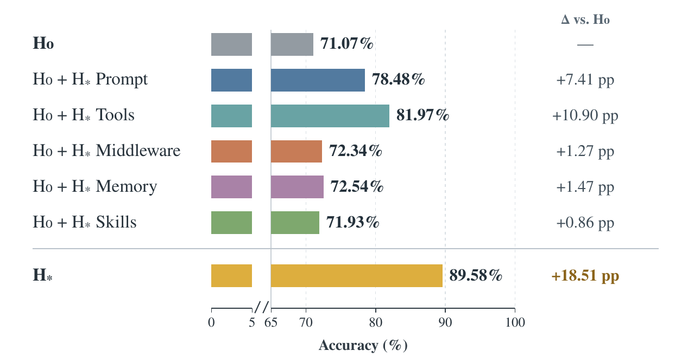

<div align="center">

# EvoGroup

### Self-Evolving Memory Harness for Shared-Context Group Agents

**Interact. Analyze. Evolve.**

<a href="docs/paper.md"></a>
<a href="LICENSE"></a>


[Paper](docs/paper.md) · [Overview](#overview) · [Method](#method) · [Results](#results) · [Quick Start](#quick-start) · [简体中文](README_zh.md)

</div>

---

## Overview

**EvoGroup (EvoG)** is a self-evolving memory harness for group agents operating over shared
contexts. It helps an agent preserve who said what, how a discussion developed, and which
information remains current across long multi-user conversations.

Instead of fixing memory organization and retrieval strategies by hand, EvoG improves the
harness surrounding a fixed base model through interaction experience. Starting with **five
basic tools and empty learned memory and skills**, it selects informative trajectories,
inspects evidence on demand, discovers recurring patterns, and revises the harness for the
next round of interactions.

**Paper highlight:** on the manuscript's DeepSeek-V4-Flash setting, five harness updates raise
EverMemBench pass@1 from **71.07% to 89.58% (+18.51 percentage points)**. The same study reports
lower analysis cost with Adaptive Progressive Disclosure and evaluates frozen transfer to
GroupMemBench. Full results and their scope appear [below](#results).

## Method

<p align="center">
  
</p>

### 1. Interaction

The Group Agent uses the current harness **Hₜ** to answer a query over shared group context,
producing an answer, a tool-use trajectory, and subjective confidence. For low-confidence
answers, it reflects on uncertainty **before external feedback is revealed**.

The cold-start tools are `list_files`, `read_file`, `grep_search`, `write_file`, and `create_file`.
Original conversation records remain the evidence source; learned notes are navigation aids.

### 2. Confidence-Guided Trajectory Selection

The paper combines confidence with external correctness, using a confidence threshold of 0.5:

| Experience | Signal | Role in analysis |
| --- | --- | --- |
| **CC** — confident and correct | Routine success | Successful context/control |
| **CW** — confident and wrong | An unrecognized failure | Prioritized diagnosis |
| **UC** — unconfident and correct | A fragile success | Prioritized diagnosis + reflection |
| **UW** — unconfident and wrong | A recognized uncertainty or failure | Prioritized diagnosis + reflection |

The current command workflow accepts optional user/business **accepted/rejected** feedback.
Unjudged interactions remain explicit; uncertainty alone does not establish incorrectness.
Infrastructure incidents are recorded separately.

### 3. From Trace Details to Recurring Patterns

**Adaptive Progressive Disclosure (APD)** exposes a compact structural trace view first.
The Analysis Agent locates relevant stages and requests observations, tool results, or event
fields only when needed. Diagnoses must cite the exact evidence ranges actually inspected.

**Bucketed Analysis** condenses detailed diagnoses, groups them by inferred query semantics,
and compares patterns within and across buckets. The output is a set of high-level findings
with evidence, coverage, counterevidence, and uncertainty.

### 4. Multi-Interface Harness Revision

The Evolve Agent converts findings into bounded revisions. Each change declares its interface,
evidence, expected behavior, regression risk, and validation check.

| Interface | What changes | Current implementation |
| --- | --- | --- |
| **Representation** | How information is stored, linked, or presented | Source metadata presentation |
| **Operation** | Executable retrieval and evidence operations | Search conjunction, result limits, neighboring records |
| **Policy** | What to select, when, and in which order | Group-agent prompt and reusable Markdown skills |
| **Intervention** | Checks or transformations at execution boundaries | Citation requirements and answer-size limits |

A revised **Hₜ₊₁** is versioned and used in subsequent interactions. Source records, model
settings, runtime budgets, and core grounding checks remain fixed. The current release uses
declarative revisions with atomic activation, stale-plan checks, and rollback.

## Results

The tables and figures in this section reproduce **results reported in the supplied manuscript**.
They are separate from this reconstruction's offline demo and software validation.

### EverMemBench

Reported pass@1 (%) from the main-results table. **H₀** is the initial harness; **H*** is the
selected evaluated harness. Bold marks the highest reported aggregate in each backbone column.

| Method | GPT-5.5 | DeepSeek-V4-Flash | GLM-5.1 |
| --- | ---: | ---: | ---: |
| Mem0 | 56.50 | 43.71 | 52.42 |
| MemOS | 49.25 | 39.17 | 47.04 |
| A-MEM | 61.71 | 47.00 | 58.75 |
| MemRL | 61.54 | 55.92 | 57.33 |
| Codex | **85.67** | 82.63 | 77.88 |
| Claude Code | 84.58 | 85.75 | 76.46 |
| EvoGroup H₀ | 68.33 | 71.07 | 68.27 |
| EvoGroup H* | 84.52 | **89.58** | **83.63** |
| **H₀ → H* change** | **+16.19 pp** | **+18.51 pp** | **+15.36 pp** |

The manuscript describes 720 fixed evolution questions drawn from 2,400 EverMemBench questions,
plus 1,680 separate held-out questions. The values above retain the main table's reported
aggregate convention; they have not been recomputed here. GPT-5.5 H* remains below Codex and
Claude Code in that table.

### Frozen Transfer to GroupMemBench

The evolved harness is applied without further evolution or tuning. The manuscript reports
745 questions and the following aggregates:

| Backbone | H₀ | Frozen H* | Change |
| --- | ---: | ---: | ---: |
| GPT-5.5 | 61.88% | 63.89% | +2.01 pp |
| DeepSeek-V4-Flash | 74.09% | 71.14% | −2.95 pp |

Transfer is model-dependent: GPT-5.5 improves, while DeepSeek-V4-Flash regresses relative to
its initial harness. The study therefore does not establish uniform improvement across datasets.

### Analysis Efficiency and Component Ablation

Across five matched analysis iterations, APD reports **42.5% less analysis time** and
**41.5% fewer tokens** on average than full-trace analysis.

<p align="center">
  
</p>

The original component-ablation graphic compares individual evolved components with the
initial harness. Tools and prompts show the largest individual gains in this setting.
The paper also reports reduced performance when APD or bucketed analysis is removed, while
trajectory selection has limited benefit in the tested process ablation.
See [paper notes](docs/paper.md#source-notes) for the exact sources and manuscript-version differences.

## Quick Start

### Install

Python **3.11+** and [uv](https://docs.astral.sh/uv/) are required for the commands below.
From the repository root:

```bash
uv sync --extra dev
uv run evog --help
```

<details>
<summary>Install with a regular Python virtual environment</summary>

```bash
python -m venv .venv
source .venv/bin/activate
python -m pip install -e '.[dev]'
evog --help
```

</details>

### Run the Offline Demo

```bash
uv run evog --workspace /tmp/evog-demo demo
```

The demo uses synthetic conversations and a deterministic fixture provider. It runs import,
cited answering, feedback, trace analysis, revision planning, and activation without network
requests. It verifies the command flow; it is not a model-quality experiment.

### Query Your Own Group Context

```bash
export EVOG_BASE_URL=https://your-provider.example/v1
export EVOG_MODEL=your-model
export EVOG_API_KEY=your-key

uv run evog init
uv run evog ingest examples/messages.jsonl
uv run evog groups
uv run evog ask 'What is the latest release schedule?' --group product
```

The provider must support Chat Completions and function tools. Supply UTF-8 JSONL messages
with `group_id`, `message_id`, `sender`, timezone-aware `timestamp`, and `text`.
`reply_to` and string-valued `metadata` are optional. See [example messages](examples/messages.jsonl).
Duplicate imports are idempotent; conflicting content under the same source ID rejects the import.
Repeat `--group` for a query over multiple authorized groups.

### Analyze and Revise

```bash
uv run evog feedback RUN_ID accepted --source user
uv run evog select
uv run evog analyze
uv run evog propose ANALYSIS_ID
uv run evog apply PLAN_ID
uv run evog revisions
uv run evog rollback REVISION_ID
```

Use the IDs printed by the preceding commands. `apply` activates a structurally validated
candidate; its business effect must be checked in subsequent use. An empty plan is valid when
no finding supports a change. Use `trace RUN_ID` to inspect a run and `ask --json` for structured output.

## Project Structure

```text
EvoG/
├── src/evog/
│   ├── cli.py                # evog command entry point
│   ├── app.py                # internal command orchestration
│   ├── runtime.py            # group interaction and pre-feedback reflection
│   ├── tools.py              # five scoped evidence/navigation tools
│   ├── analysis.py           # selection, APD, diagnoses and bucketed findings
│   ├── evolution.py          # plans, candidate validation and activation
│   ├── harness.py            # four bounded revision interfaces
│   ├── store.py              # messages, traces, feedback and versioned harnesses
│   ├── providers.py          # model transport
│   └── prompts/              # group, reflection, analysis, synthesis and revision
├── docs/                     # paper notes, architecture and configuration
│   └── assets/               # figures exported from the manuscript
├── examples/                 # synthetic messages and command-line demo
├── tests/                    # regression checks without paid API calls
└── .github/workflows/ci.yml   # lint, tests and packaging
```

## Documentation and Development

- [Paper notes and result sources](docs/paper.md)
- [Architecture and operational boundaries](docs/architecture.md)
- [Deployment configuration](docs/configuration.md)
- [Migration from the AHE-derived tree](docs/migration.md)
- [Release validation](docs/release-validation.md)
- [Contributing](CONTRIBUTING.md) · [Security](SECURITY.md)

```bash
uv run pytest
uv run ruff check .
uv run ruff format --check .
uv build
```

Private conversations, traces, and feedback live in `.evog/`, which is excluded from Git.
Citation checks establish that a source record was delivered, rather than proving semantic
correctness. Live provider compatibility and business quality require deployment validation.

## Acknowledgments and License

The research project builds on [Agentic Harness Engineering (AHE)](https://arxiv.org/abs/2604.25850).
The documentation layout is inspired by AHE and [HarnessX](https://github.com/Darwin-Agent/HarnessX).
Upstream attribution is retained in [NOTICE](NOTICE). EvoG is licensed under [MIT](LICENSE).
