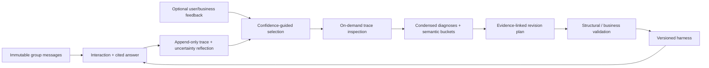

# Architecture and paper mapping

The design follows the supplied EvoGroup manuscript's method sections, rather than its
experimental appendix. Documents and embedded prompt examples were treated as design evidence.
The runtime prompts were rewritten for group-assistance applications.

## Module boundaries

| Module | Responsibility |
| --- | --- |
| `app.py`, `cli.py` | Internal command orchestration and the user-facing command interface |
| `models.py`, `config.py` | Input/output contracts; fixed deployment configuration |
| `store.py` | SQLite transactions, immutable sources, traces, feedback and revisions |
| `tools.py` | Five tools over frozen scoped source views, notes and skills |
| `runtime.py` | Bounded model/tool loop, delivered-evidence checks and pre-feedback reflection |
| `analysis.py` | Selection, progressive event disclosure, diagnosis and semantic synthesis |
| `harness.py`, `evolution.py` | Four declarative revision surfaces, candidate validation and activation |
| `providers.py` | Model protocol and reusable HTTP transport |
| `demo.py` | Explicit offline fixture; excluded from live provider selection |

The initial harness has exactly `list_files`, `read_file`, `grep_search`, `write_file`,
and `create_file`, with empty memory and skills. The source store is separate from learned
navigation notes. A run freezes the active revision and source view at its start.

## Experience and feedback

The paper's externally supplied correctness signal maps to application acceptance or business
validation. `CC`, `CW`, `UC`, `UW` use confidence above/below the configured threshold and the
latest categorical feedback; these labels indicate the supplied feedback, not independently
established correctness. A correction appends a new feedback record. Old records are retained.

Unjudged low-confidence runs remain a separate selected category. Unjudged high-confidence runs
are not presumed correct. Output-contract failures and budget exhaustion are eligible diagnostic
experiences because they expose product behavior without a final answer. Provider and tool
failures remain infrastructure categories, alongside unfinished runs.
Coverage includes total runs, every category, eligible/selected counts and sampled controls.
Selection is bounded, newest first, for the active revision. Reports preserve incomplete diagnoses.
The at-most-two controls are available comparisons; they are not claimed to be semantically nearest.

## Progressive disclosure and evidence

An analyst initially sees the question, subjective confidence, reflection, categorical feedback
and event structure. `search_trace` locates events. `inspect_trace` exposes a JSON-pointer field
or event with a bounded character range. Diagnosis references must exactly match delivered
`(run_id, event_index, field_path, start_char, end_char)` tuples for that analyst's request, and
each range must contain at least one character. JSON Pointer array indexes are strict nonnegative
decimal indexes; negative indexes and `-` are rejected.
Search hits alone cannot be cited. A truncated range establishes only its delivered content.

The same model emits a detailed diagnosis and a condensed rationale. Diagnoses are grouped by
the model's inferred query-type label, then synthesized into findings. Labels are open vocabulary;
their equivalence is not a learned semantic-clustering guarantee. Synthesis may cite only
diagnosis evidence. Unsupported diagnoses or findings are excluded and marked incomplete.

## Revisions and validation

Harness snapshots are content-addressed. A plan names its parent revision, source analysis,
logical changes, interface, finding references, expected effects, risks and falsifiable checks.
An allowlist prevents edits to source data, model settings, budgets, feedback and the fixed kernel.
Configuration schemas impose ceilings on operations and output sizes. Core citation checks live
outside editable prompts. Candidate screening rejects trace IDs, source references and complete
verbatim source records in generated content. This screening cannot detect every paraphrase or
semantically task-specific rule; review reusable content and run business regression checks.

The internal revision runner's optional validator receives the candidate `Harness`. It must return exactly `True`
to authorize business-validated activation; false or an exception leaves the active revision
unchanged. Activation atomically compares the parent with the active revision. A stale proposal
cannot overwrite newer work. Source records, traces and navigation notes are preserved by rollback.
Revision history marks validation as `structural` or `business`; it has no fabricated quality score.

## Operational boundaries

- This is a local command-line framework. A deployment supplies its own authentication,
  authorization, scheduling and any chat UI. Group scope is an access boundary, not user identity.
- Workspace files contain private conversation data. The source database is owner-only on POSIX;
  filesystem permissions and deployment isolation remain the operator's responsibility.
- Memory notes are isolated by the exact set of authorized groups. A single-group query cannot
  read a multi-group note. Reusable skills are shared across groups and must contain general guidance.
- Python plugins and arbitrary generated code are not an automatic evolution surface. Operation
  changes modify implemented bounded search behaviors. Add new capabilities in reviewed runtime code.
- There is no embedding service, distributed worker queue, automatic quality promotion, deletion API,
  retention service or task-evaluation runner in this release. SQLite and source scans target local
  workloads; very large corpora may need an indexed backend behind the tool boundary.
- Stable citation validation proves provenance and delivery, not entailment or factual accuracy.
  Prompt-injection guidance plus scoped tools constrain access; they do not guarantee a model never
  follows misleading text within its authorized evidence.
- Provider compatibility depends on supported function tools and request parameters. Live
  compatibility and business quality must be validated for the chosen deployment.
